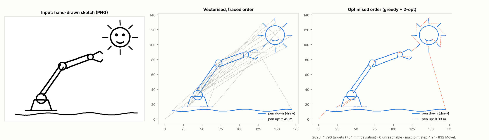
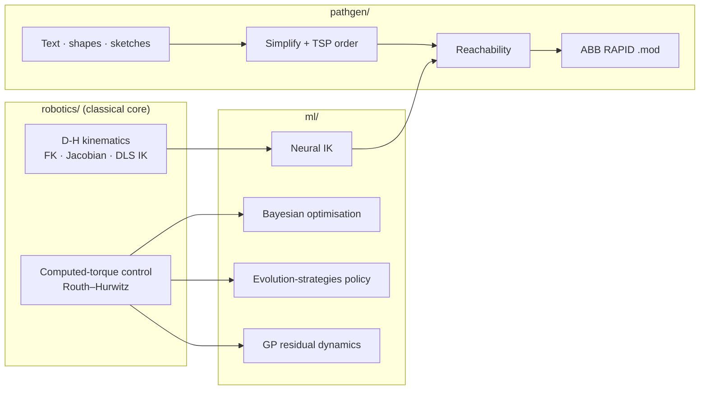
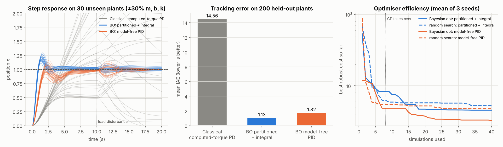
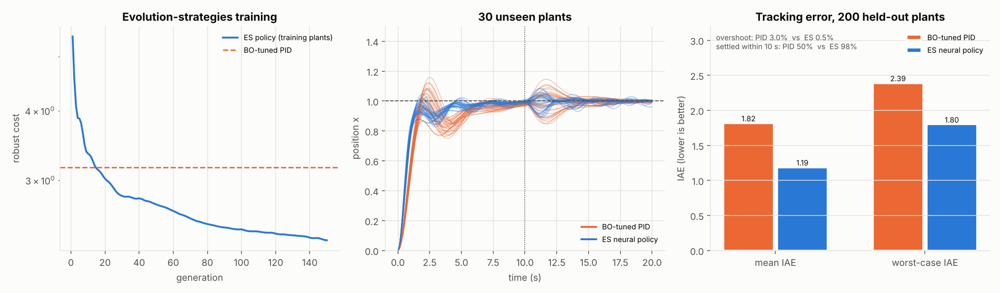
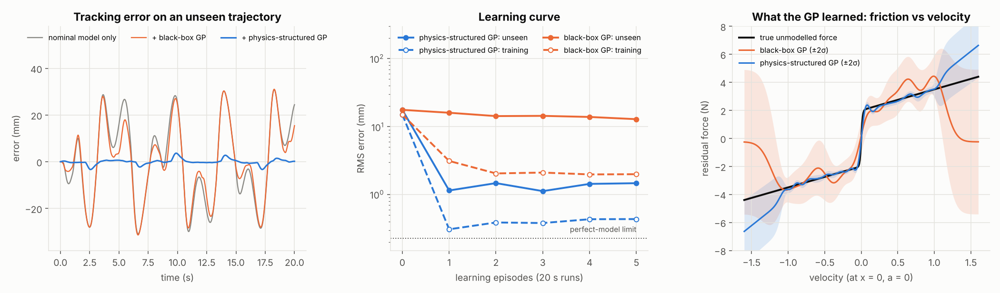

# 🧠🦾 SynapseArm

**A learning brain for a 6-DOF industrial arm.** It combines classical robotics (kinematics, computed-torque control, Routh–Hurwitz stability) with machine learning that makes the arm faster to solve, more robust to model error, and able to draw whatever you hand it.

  


<sub>A hand-drawn PNG becomes 832 `MoveL` instructions for an ABB controller. Pen-up travel is cut by 87%, and every target is IK-verified before it reaches the robot.</sub>

## Highlights

| Module | What it does | Result |
|---|---|---|
| **Neural IK** | MLP predicts joint angles, then damped least squares refines them | **99.5%** solve rate vs 38% for classical DLS; **10× faster** |
| **Bayesian-optimised control** | Gaussian-process BO tunes gains across ±30% model error, load, saturation and noise | **8–13× lower** tracking error. Exposes a textbook design that goes **unstable on 7.5%** of plants |
| **Evolution-strategies neural controller** | Neural policy trained by black-box RL on the same plants | A further **−35%** error and **0.5%** overshoot vs the best PID; settles **98%** of the time vs 50% |
| **GP dynamics learning** | Learns unmodelled friction, cogging and parameter error, then adds them as feed-forward | **15×** better tracking on a trajectory it never trained on, after one 20 s run |
| **Sketch → robot program** | Vision → strokes → TSP ordering → reachability check → ABB RAPID | **−87%** pen-up travel, **−70%** targets at ≤0.1 mm deviation, 0 unreachable points |

Everything is reproducible from a script, benchmarked on **held-out** data, and covered by unit tests. The tests check the robotics against hand-derived closed forms, and the ML against known answers.



## Quick start

```bash
pip install -r requirements.txt
pytest                                                  # 57 tests, ~10 s

python scripts/draw.py "draw a 7-pointed star 60 mm"    # -> results/drawing.{mod,png,json}
python scripts/draw.py "write 'Hello robot' 25 mm"
python scripts/draw.py --image examples/sketch.png --width 160
python scripts/draw.py --image photo.jpg --mode edges   # photos: Canny edges instead of ink lines

python scripts/train_neural_ik.py       # ~5-10 min   neural IK model + benchmark
python scripts/tune_controller.py       # ~1.5 min    Bayesian-optimised gains
python scripts/train_rl_controller.py   # ~5 min      evolution-strategies neural controller
python scripts/learn_dynamics.py        # ~2 min      GP dynamics learning
python scripts/plot_workspace.py        #             reachable workspace, coloured by manipulability
```

---

## 1 · Neural inverse kinematics

`ml/neural_ik.py`: numerical IK is accurate but needs a good starting guess. From a poor seed it's slow, lands on the wrong configuration, or fails near limits and singularities. A multilayer perceptron, trained on 150k poses generated from the arm's own forward kinematics (so no external data is needed), predicts the joints in microseconds. Damped least squares then polishes that guess to nanometre accuracy in a handful of iterations.

- **Branch-consistent training.** IK is one-to-many (elbow up/down, wrist flip). Trained on every solution, a regression network averages between them, so it's trained on one configuration branch. That's the same idea as an industrial controller's `confdata`.
- **Angle encoding.** Joints are predicted as (sin θ, cos θ), so the ±180° wrap of the wrist doesn't confuse the network.

Benchmark on 500 random reachable 6-DOF poses (`results/neural_ik_benchmark.json`):

| Strategy | Success rate | Median position error | Mean iterations | Time per solve |
|---|---|---|---|---|
| Neural net only | 0.0% | 60.9 mm | 0 | 0.01 ms |
| DLS from home pose | 38.0% | 8.17 µm | 66.3 | 13.61 ms |
| DLS from random seed | 22.0% | 516.6 mm | 80.5 | 16.42 ms |
| **Neural net + DLS (hybrid)** | **99.5%** | **1.2 nm** | **4.6** | **1.31 ms** |

The network alone is too coarse to drive the arm, but it's an excellent initial guess. That's how learned IK is used in practice.

## 2 · Robust controller tuning with Bayesian optimisation

`ml/bayes_opt.py` (Gaussian process + Expected Improvement, written from scratch on scikit-learn) and `ml/controller_tuning.py`. One axis is modelled as a mass-spring-damper (m = 7, b = 1, k = 9). Gains are tuned to hold up when the real plant **isn't** the model:

- true m, b, k each off by up to **±30%**
- an unknown **±3 N step load** at t = 10 s
- actuator saturation **|f| ≤ 30 N** with anti-windup, plus position and velocity sensor noise

Each candidate is simulated on 24 training plants at once (vectorised NumPy). The cost is mean + ½σ of IAE + control chatter + overshoot. Every design is then scored on **200 held-out plants**.



| Design | Gains (kp, kd, ki) | Mean IAE | Worst IAE | Overshoot | Settled ≤10 s | Error after load | Unstable plants |
|---|---|---|---|---|---|---|---|
| Classical computed-torque PD (ζ = 1, ωn = ½√(k/m)) | 0.321, 1.13, 0 | 14.56 | 46.17 | 42% | 2% | 1.135 | **7.5%** |
| BO: computed-torque + integral | 6.57, 2.47, 0.457 | 1.13 | 1.95 | 20% | 63% | 0.018 | **0%** |
| BO: model-free PID | 12.3, 8.7, 5.59 | 1.82 | 2.39 | 3% | 50% | 0.005 | **0%** |

- **The textbook design is fragile.** Its `+k·x` feed-forward cancels the *nominal* spring. If the true k is more than 25% lower than modelled, the net stiffness `m·kp + k_true − k_nom` goes negative and the loop is **unstable**. This is proven per plant with a Routh–Hurwitz test (`linear_stable`) and confirmed in simulation.
- **BO's designs stay stable on every unseen plant** and cut tracking error 8–13×.
- **BO is sample-efficient.** Averaged over 3 seeds, it matches random search's 40-simulation result in 15–18 simulations. That matters when each evaluation is a real hardware trial.

## 3 · Neural controller trained with evolution strategies

`ml/rl_policy.py`: the controller is a learned linear PID term plus a 16-unit tanh network. It's trained by **OpenAI-style evolution strategies** (antithetic perturbations, centred-rank fitness shaping, Adam). Each generation, the whole population is simulated on every training plant in **one batched simulation**, which takes about 2 s on a laptop CPU. The scenarios, cost and held-out test set are the same as in §2.



| Controller (200 held-out plants) | Mean IAE | Worst IAE | Overshoot | Settled ≤10 s | Control effort (TV) |
|---|---|---|---|---|---|
| BO-tuned PID | 1.82 | 2.39 | 3.0% | 50% | 512 |
| **ES neural policy** | **1.19** | **1.80** | **0.5%** | **98%** | 511 |

The policy learned to drop its linear derivative term (kd ≈ 0) and do the damping nonlinearly through the network. It's faster without overshooting, at the same control effort. **Caveat:** unlike a PID, a neural policy has no Hurwitz certificate. Robustness here is shown empirically across 200 unseen plants, with 0 divergences. Formal guarantees (Lyapunov or IQC-based) would be the next step before any hardware use.

## 4 · Learning unmodelled dynamics with a Gaussian process

`ml/gp_dynamics.py`: a computed-torque controller is only as good as its model. Here the true axis has a heavier payload, 2.5× the viscous damping, a softer spring, **Coulomb friction** and position-dependent **cogging**. After each 20 s run, a GP learns the force the model misses, `r = f − (M a + B v + K x)`. Its mean is then added as feed-forward along the next reference, which is iterative learning control. Where the GP's predictive σ is high, the correction is faded out.

The key design choice is the **physics-structured kernel**:

`k = linear(x, v, a) + RBF(x) + RBF(v) + noise`

That is, parameter error + cogging(x) + friction(v). It's implemented from scratch, with hyperparameters fitted by marginal likelihood. Compared with a black-box 3-D RBF GP:



| RMS tracking error | Training trajectory | **Unseen trajectory** |
|---|---|---|
| Nominal model only | 15.1 mm | 17.7 mm |
| + black-box RBF GP (5 runs) | 2.0 mm | 12.9 mm |
| **+ physics-structured GP (1 run)** | **0.31 mm** | **1.15 mm** |
| Perfect model (lower bound) | 0.17 mm | 0.23 mm |

The black-box GP memorises the training trajectory. The structured GP learns the *physics*: the right panel shows it recovering the friction curve, with uncertainty growing where it has no data. So it carries over to motions it has never seen.

## 5 · Sketch / text → ABB RAPID program

`pathgen/` goes from a request to a robot program in one call:

1. **Sources** (`sources.py`): text (font outlines), parametric shapes, or **images**. Sketches are binarised (Otsu) and skeletonised to 1-px centre-lines, then the skeleton graph is traced into polylines. Photos go through Canny edge detection instead.
2. **Optimisation** (`optimize.py`): Ramer–Douglas–Peucker simplification within a tolerance. Then stroke ordering, solved as a generalised TSP (each stroke can be drawn either way): greedy nearest neighbour, then 2-opt with direction flips.
3. **Reachability** (`reach.py`): every target is mapped through the paper work-object and pen tool, solved with the §1 neural-IK hybrid, and followed with continuation so the joint path stays on one branch. It reports unreachable points, closeness to singularity, and the largest joint jump.
4. **RAPID** (`rapid.py`): a self-contained module with `tooldata`, `wobjdata` and `speeddata`. Coordinates are written relative to the work-object, so the program runs wherever the sheet is calibrated. Drawing moves use fine points at touchdown and small zones while drawing, and long programs are split into procedures.

| Job | Strokes | Targets (raw → simplified) | Pen-up travel (traced → greedy → 2-opt) | Unreachable | Max joint step |
|---|---|---|---|---|---|
| Hand-drawn sketch | 39 | 2693 → 793 | 2.49 m → 0.38 m → **0.33 m** | 0 | 4.9° |
| `write 'SynapseArm' 22 mm` | 14 | 644 → 363 | 0.19 m → 0.19 m → 0.18 m | 0 | 1.6° |
| `draw a 7-pointed star 60 mm` | 1 | 15 → 15 | n/a | 0 | 1.6° |

Example outputs, ready to load in RobotStudio, are in [`examples/`](examples/) (`*.mod`).

---

## Repository layout

```
robotics/    kinematics.py (D-H, FK, Jacobian, DLS IK, analytic wrist-centre IK), workspace.py, control.py
ml/          neural_ik.py · bayes_opt.py · controller_tuning.py · rl_policy.py · gp_dynamics.py
pathgen/     sources.py · optimize.py · reach.py · rapid.py · pipeline.py
scripts/     one entry point per experiment (all reproducible, fixed seeds)
tests/       57 pytest tests
models/      trained neural-IK model, ES policy
results/     benchmark JSON + figures
examples/    sample sketch and generated RAPID programs
```

## Engineering notes

- **Kinematic model.** Standard D-H with a (mm) = [150, 760, 140, 0, 0, 0], α = [90°, 0, 90°, −90°, 90°, 0], d = [505, 0, 0, 795, 0, 0]. That's an offset shoulder and a spherical wrist, the typical ABB IRB geometry. FK is tested against the hand-derived closed form Px = c1(150 + 760c2 + 140c23 + 795s23), Pz = 505 + 760s2 + 140s23 − 795c23. The Jacobian is tested against finite differences.
- **Honest baselines.** Every learned method is compared with a reasonable classical one on the same data: DLS IK, a textbook computed-torque design, random search, a black-box GP, and a perfect-model oracle.
- **Held-out evaluation.** Controllers are tuned on 24 plants and scored on 200 different ones. The dynamics model is trained on one trajectory and scored on another.
- **Simulation-only.** Results come from simulated plants with noise, saturation and model error. They have not been run on hardware.

## Roadmap

- [x] Neural IK + hybrid solver
- [x] Bayesian-optimised robust gains
- [x] Evolution-strategies neural controller
- [x] GP residual dynamics + iterative learning
- [x] Sketch / text → RAPID with reachability checking
- [ ] Learned reachability and manipulability map for fast path placement (gradient boosting or MLP)
- [ ] Anomaly / collision detection on joint trajectories (autoencoder, isolation forest)
- [ ] Natural-language requests via an LLM (the request parser is rule-based for now)
- [ ] Extend learned dynamics and control from one axis to the full 6-DOF arm
